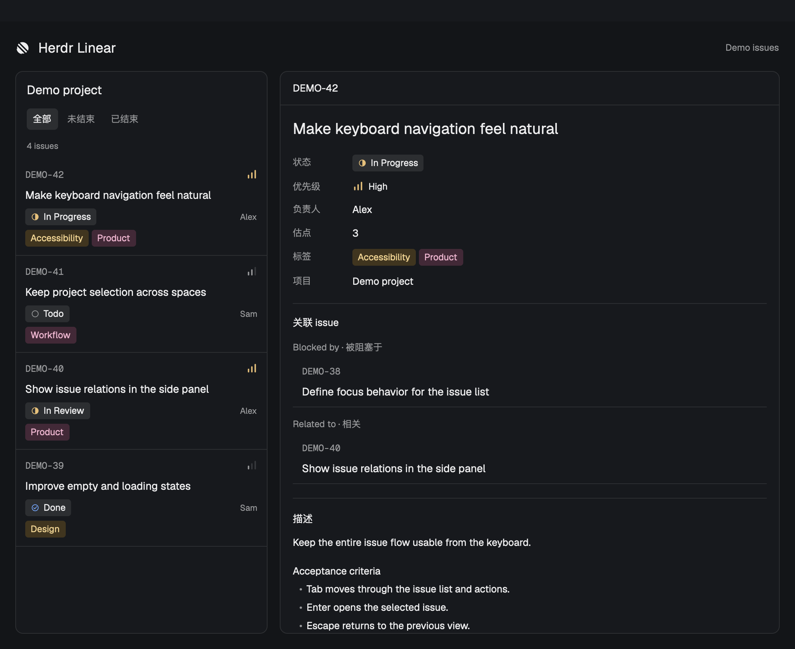

# Herdr Linear

A native [Herdr](https://herdr.dev) mod for reading Linear issues beside your terminals. Connect a Linear project to a Herdr space, then open its issues from the Linear button in the tab bar.



*List and detail views shown side by side with demo data. Interface labels are currently in Chinese.*

## What it does

- Connect through Linear's browser OAuth flow, with read-only access.
- Remember a different project for each space.
- Mark a space as not needing Linear. The panel closes automatically when you enter that space; you can reopen it to change the setting.
- Show issue identifiers, status icons, priority icons, assignees, and colored labels.
- Search by identifier, title, status, or assignee, and filter open or ended issues.
- Read descriptions, embedded Linear images, estimates, labels, and issue relations inside the panel.
- Follow **Blocked by**, **Blocks**, **Related to**, **Duplicate of**, and parent issue links. Use Back or Escape to return.
- Refresh manually, or every minute while the panel is visible.

## Requirements

- macOS. OAuth credentials are stored in macOS Keychain.
- Node.js 22 or later and npm.
- Herdr running, with `herdr-app` available on your PATH. Tested with Herdr 0.1.13.
- A layout with a `tabs` block and either a `panel-body` stack or a `work-body` row. Herdr's default `main` layout has these nodes.

The panel uses Herdr's native GPUI mod API. It runs inside Herdr; there is no standalone web app.

## Install

```sh
git clone https://github.com/neilforest7/herdr-linear.git
cd herdr-linear
npm ci
node install.mjs
```

The installer copies `mods/linear` into your Herdr home, adds the tab-bar button and side panel to the current layout, and saves a layout backup before changing it. A supported built-in layout is cloned first. Layouts without the required nodes are rejected.

Open **Linear** in the tab bar, authorize access in your browser, and select a project. The choice applies to the current space. In the project picker, **这个 space 不需要绑定 Linear** means “This space doesn't need Linear.”

Keep this checkout in place: the installed mod calls the helper from this directory. After moving the checkout, run the installer again.

For a custom Herdr home, use the same environment variable when starting Herdr and installing the mod:

```sh
HERDR_APP_HOME=/path/to/herdr-home node install.mjs
```

## Update

```sh
git pull --ff-only
npm ci
node install.mjs
```

Run the installer in each layout where you want the button. Herdr updates preserve custom mods and layouts; changes to Herdr's mod API may require an update to this project.

## Authorization and local data

The helper connects to [Linear's official MCP server](https://linear.app/docs/mcp) at `https://mcp.linear.app/mcp/readonly`, using OAuth with PKCE and dynamic client registration. You do not need to create a Linear OAuth application or paste an API key.

OAuth tokens and client registration are stored in the **Herdr Linear MCP** entry in macOS Keychain. Project bindings and skipped-space choices are stored in Herdr's shared state. Helper paths and downloaded issue images are stored under `data/linear/` in your Herdr home. The browser login status file is stored at `data/linear-auth.json` in your Herdr home.

All Linear requests run on your Mac, including when you work in a remote Herdr space. If authorization expires and cannot be refreshed, open the panel and authorize again.

To remove the local OAuth credentials:

```sh
node helper/client.mjs logout
```

This clears the Keychain entry. You can also revoke the app's access in Linear.

## Development

```sh
npm test
herdr-app check mods/linear
```

The Node tests cover OAuth callback validation, pagination, issue data, description rendering inputs, image handling, and space auto-collapse behavior. `herdr-app check` validates the initial native view; it does not replace checking later states in the running app.

| Path | Purpose |
| --- | --- |
| `mods/linear/` | Native panel, button, UI components, and icons |
| `helper/` | OAuth, MCP requests, issue normalization, and image handling |
| `install.mjs` | Install the mod and connect it to a layout |
| `RECIPE.md` | Mod structure and behavior for Herdr agents |

## Credits and license

The button and side-panel integration follows the approach in [Herdr Issues](https://github.com/jankeesvw/herdr-issues). Herdr Linear is an independent community mod.

[MIT](LICENSE). [中文说明](README.zh-CN.md).
