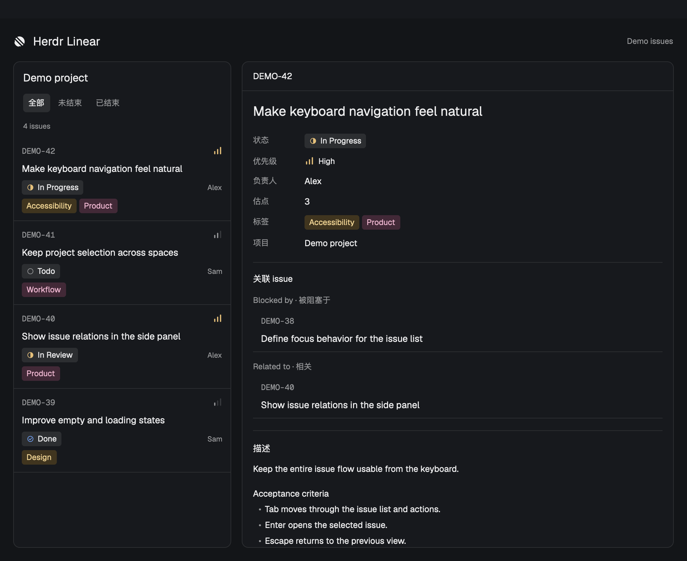

# Herdr Linear

[English](README.md) · 中文

在 Herdr 终端旁查看 Linear issues。每个 space 可绑定一个 project，点 tab bar 右侧的 Linear 即可打开。



*列表与详情并排展示，使用演示数据。*

## 安装

把这句话发给运行在 Herdr 中的 agent：

```text
Read ~/.config/herdr-app/AGENTS.md, then add this mod: https://github.com/neilforest7/herdr-linear/tree/main
```

需要 macOS 和 Node.js 22+。agent 完成安装后，你只需在浏览器授权 Linear，再在面板选择 project。[详细安装说明](INSTALL.md)。

## 功能

- **按 space 绑定项目。** 也可选择不需要 Linear，切入该 space 时面板自动收起。
- **一眼看清 issues。** 编号、状态与优先级图标、负责人和彩色标签，支持搜索和筛选。
- **面板内查看详情。** 描述、图片、估点、标签和关联关系；点击关联 issue 继续查看，返回或 Escape 回到上一层。
- **只读授权。** 通过 Linear 官方 MCP 的浏览器 OAuth 授权，凭据保存在 macOS 钥匙串。面板显示时每分钟刷新。

## 更新

告诉 agent：

```text
Read ~/.config/herdr-app/AGENTS.md, then update my Herdr Linear mod from: https://github.com/neilforest7/herdr-linear/tree/main
```

## 文档

- [安装、授权与开发说明](INSTALL.md)
- [模块结构与行为](RECIPE.md)

按钮和侧栏接入方式参考 [Herdr Issues](https://github.com/jankeesvw/herdr-issues)。采用 [MIT 许可证](LICENSE)。
