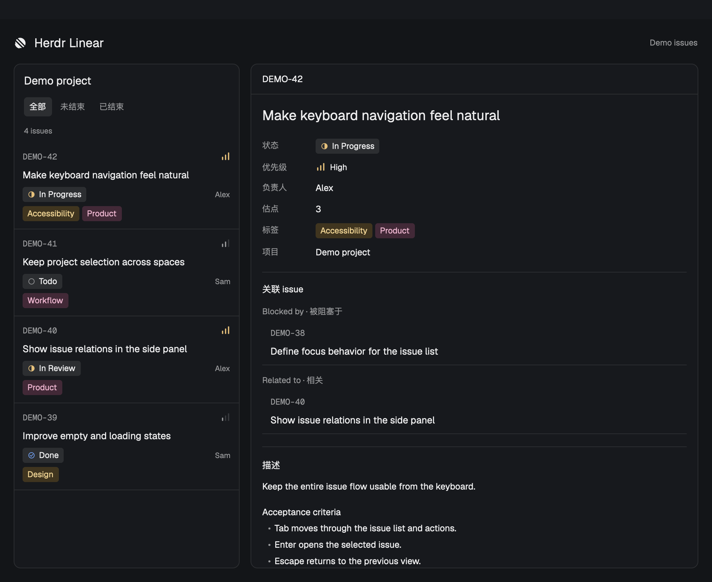

# Herdr Linear

A native side panel for reading the Linear project linked to the current Herdr space. Open it from the Linear button beside the tab bar.

## What you see

- A Linear button in the tab bar, selected while the panel is open.
- An initial authorization screen, then a project picker scoped to the current space. The picker also offers a choice to skip Linear for this space.
- An issue list with identifiers, status icons, priority icons, assignees, and colored tags. Search and open/ended filters sit above it.
- A detail view with Back, the issue identifier, a link to Linear, and refresh. The title leads, followed by status, priority, assignee, estimate, labels, relations, and the description.
- Directional relation groups: Blocked by, Blocks, Related to, and Duplicate of. Issue references open their details in the panel.

## How it behaves

A project or skip choice is stored per space. Entering a skipped space closes the Linear panel. Manually opening it permits choosing a project again. A late panel restore from another mod must not override this choice.

Opening an issue fetches its current details. Back or Escape returns to the previous issue or list. Search and list filters survive detail navigation. Request epochs prevent a response from an earlier space or issue from replacing the current view.

The panel refreshes every 60 seconds while visible. Browser authorization is checked every 2 seconds while pending. Loading, empty, error, retry, and expired-authorization states are distinct. A refresh retains existing data while the request runs.

Descriptions preserve their text. Linear issue nodes become links, and embedded Linear images are fetched through the authenticated MCP connection and cached locally. Code examples remain literal. Headings are scaled below the issue title. Tags receive stable colors based on their names.

## Built from

- `mods/linear/main.js`: the panel and the button (`props().button`).
- `mods/linear/ui.js`: buttons, tags, status and priority marks, issue rows, and the detail body.
- `mods/linear/model.js`: layout lookup, filters, links, and description heading presentation.
- `helper/client.mjs`: the official MCP SDK, read-only Linear MCP transport, OAuth with PKCE, and macOS Keychain storage.
- `helper/issue.mjs`: issue and relation normalization.
- `helper/description.mjs`: native Linear description nodes and image storage.
- `install.mjs`: connects the module to `tabs` and `panel-body`, or creates a panel under `work-body`.

The installer copies the mod and stores the checkout's helper path under Herdr's `data/linear/`. It backs up changed layouts, checks for concurrent layout edits, and clones supported built-in layouts before changing them. The helper runs locally with Node.js; the mod itself uses native GPUI elements.

## Watch out

The current interface labels are Chinese. macOS is required for Keychain and browser launching. Herdr 0.1.13 was used during development; its generated type files are the API reference and are excluded from this repository.

Keep OAuth credentials in Keychain and runtime state outside the checkout. Keep preview data fictional. Do not copy personal layouts or screenshots containing private issues into the repository.

The installer requires a `tabs` block plus either a `panel-body` stack or `work-body` row. It rejects other layouts. Moving the checkout requires rerunning the installer because the helper path is absolute.

## Done when

- `npm test` passes.
- `herdr-app check mods/linear` passes.
- Linear opens from the tab bar and browser authorization reaches the project picker.
- A selected project follows its space, and a skipped space collapses the panel while allowing manual reopening.
- Issue status, priority, identifiers, and labels appear in the list.
- Details match Linear, relations keep their direction, and Back returns to the previous view.
